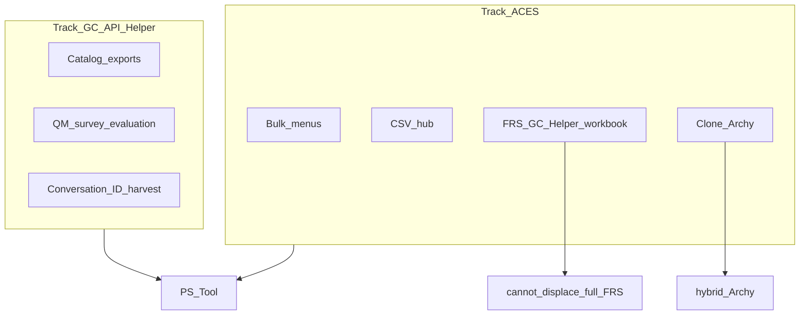

# Displace ACES and GC_API_Helper with PS Tool

This document is the product contract for replacing **ACES** (Advanced Cloud Expert Script) and **GC_API_Helper** with the **Genesys PS Tool** web app wherever feasible. It complements the extension migration matrix in [`migration-matrix.md`](migration-matrix.md).

**Shipped in PS Tool 0.2.0 (Phase 0):** export registry, catalog exports in the web UI, documentation ZIP (`exportAll`), and job types `catalog-export` / `export-batch`. Upgrade server and extension together — see [Upgrading in README](../README.md#upgrading-020).

**Reference sources (external to this repo):**

- ACES operator docs — e.g. `ACES_MacX86/docs` (`operator_guide.md`, `ACES_menu_reference.html`, `FRS_README.md`, `FRS_TAB_SPECS.md`).
- GC_API_Helper — October 2026 full package (`README_GC_API_Helper.md`, `GC_API_Helper.py` `list_of_modules`).

---

## Executive summary

PS Tool is intended to become the **default PS operator surface** for Genesys Cloud: exports, bulk workflows, interaction diagnostics, notifications, and server-side admin features that neither ACES nor GC Helper provide today.

| Legacy toolkit | Primary role | Displacement strategy |
| --- | --- | --- |
| **GC_API_Helper** | 62 read-only API extract modules → org-scoped files | **High ROI** — extend PS Tool Exports + async job downloads until operators no longer launch the Python GUI |
| **ACES** | Provisioning, clone-to-org, FRS/GC Helper workbooks, cleanup, CSV hubs | **Mixed** — many **bulk operator** flows already displaced; **FRS apply** and **full-org clone** remain long-horizon or hybrid |

Success is measured by shrinking mandatory ACES/GCH installs per engagement, not by claiming 1:1 parity with every ACES menu row on day one.

---

## Displacement status legend

| Status | Meaning |
| --- | --- |
| `displaced` | PS Tool covers the workflow; legacy tool not required for that task |
| `partial` | Core path in PS Tool; legacy tool still needed for extra columns, system prompts, scale, or workbook format |
| `planned` | Scoped for PS Tool; implementation phase documented below |
| `hybrid` | PS Tool owns UX/API where built; an external or legacy step remains (e.g. Archy publish) |
| `cannot-displace` | Not targeted for full parity; mitigation documented |

---

## Architecture: two tracks

- **Track A** aligns with PS Tool’s export-table pattern, `src/lib/*` helpers, and concurrent job processing (see README).
- **Track B** includes surfaces already marked `done` in [`migration-matrix.md`](migration-matrix.md) plus provisioning/clone work that may never reach full parity.

---

## Already displaced (legacy → PS Tool)

| Legacy surface | PS Tool | Evidence |
| --- | --- | --- |
| Extension / GC Helper-style user, role, skill, phone, queue, skill, group catalog exports | Export tables + CSV | [`README.md`](../README.md) Exports; migration matrix `done` |
| User roles / skills mapping exports | Role-mappings, skill-mappings exports | migration matrix |
| Queue / group member exports | Selector-driven exports | migration matrix |
| Prompts (user) export + bulk import package | Prompts export, `export-package` ZIP | README Prompts export |
| Data tables (content) | Multi-select ZIP (`showbrief=false`) | `datatables/export-package` |
| Disconnect open queue interactions | Bulk Disconnect | migration matrix; ACES menu **0** equivalent |
| Priority on queued interactions | Priority Updater | migration matrix |
| Bulk skills, roles, auto-answer, password reset, logoff, WebRTC phone build | Bulk Actions | README; migration matrix |
| Phone move / delete / site migrate | Phone Mover, Remover, Site Migrator | migration matrix |
| Single-conversation inspect | Conversation Data / Attributes | migration matrix |
| Flow execution debug (read path) | Flow execution + Architect timeline viewer | migration matrix |
| Organization limits snapshot | Dashboard Organization Limits widget | migration matrix |
| OAuth / org connection files | Extension vault + session (`POST /api/launch/start`) | README; replaces GCH Encryptor JSON + ACES credential profiles (different UX) |
| Audit log query | Genesys Audit Log Viewer | migration matrix |
| Notification subscriptions | User / Queue / Outbound + parsed messages | migration matrix |

**ACES-only today but PS Tool unique (no GCH/ACES replacement needed):** Chat Agent Tester, Mock API, PS Tool operator admin dashboard, dual audit viewers, notification message parser.

---

## Phased implementation roadmap

### Phase 1 — GC_API_Helper export displacement (catalog + gaps)

**Goal:** Stop using GC Helper for baseline org documentation except where status is `partial`.

| PS Tool feature area | Pattern |
| --- | --- |
| Exports nav — “wide” catalog CSVs | Thin routes in `src/routes/genesys.js`, logic in `src/lib/*-export.js`, GUX export table or job + blob download |
| Long extracts | Reuse concurrent job queue (README); stream CSV to disk/session storage |
| Batch documentation | Documentation export ZIP + `export-batch` job (**shipped**); extend registry per backlog |

### Phase 2 — GC_API_Helper QM and analytics

**Goal:** Displace Evaluation/Survey design and results modules with server-side CDA pipelines and checkpoint/resume (not a desktop GUI).

**Dependencies:** OAuth scopes for Quality/Analytics, acceptable server runtime and storage, progress persistence.

### Phase 3 — ACES operator menus (mutations and CSV)

**Goal:** Displace day-to-day ACES menus that are not full FRS/clone.

| Target | PS Tool direction |
| --- | --- |
| Prompts CSV import parity with ACES `tts_` / `text_` / `audio_` columns | Extend import package / upload workflow (`partial` today) |
| Update Roles — permission merge from spreadsheet column A | New bulk workflow with dry-run + catalog resolution |
| User menu — non-destructive CSV provision subsets | Bulk workflows aligned with ACES user provision schema (preview-first) |
| Cleanup menu (8) | Implement per-action with confirmation + audit |
| CSV & bulk routing (12–13) | DID / call route CSV tools (templates in ACES `templates/`) |
| Presence (14), Decisions (15) | Targeted exports or bulk tools |
| Bot NLU merge (19) | `planned` per action; may be `cannot-displace` for merge-specific logic |

### Phase 4 — Provisioning and clone (selective)

**Goal:** API-first clone/apply only where PS Tool can own safety (preview, ledger, rollback design).

| Capability | Stance |
| --- | --- |
| Clone-to-org per object type (no Archy) | `planned` / `hybrid` — data tables schema, wrap codes, skills, queues, etc. |
| Archy flow export/import/publish | `hybrid` — keep Archy until API-only publish is acceptable |
| GC Helper workbook ingest (ACES menu **18**) | `hybrid` until FRS engine exists in PS Tool |
| FRS dry-run / apply / rollback (~65+ tabs) | `cannot-displace` (full parity) medium term; partial tab groups `planned` long term |
| Full-org clone orchestrator + `./clone/` ledgers | `cannot-displace` or long-horizon `planned` |
| FRS/GCH rollback ledgers | Prerequisite design if any Phase 4 apply ships |

---

## GC_API_Helper — module displacement matrix (62 modules)

Source: `GC_API_Helper.py` `list_of_modules` (October 2026 build).

| Module | Status | Phase | PS Tool target / notes |
| --- | --- | --- | --- |
| Agent Contacts | `planned` | 1 | Exports — user contact fields |
| Agent Details | `partial` | 1 | Users export (fewer columns than GCH) |
| Agent Details Plus | `planned` | 1 | Exports — extended user/agent columns |
| Agent Licenses | `planned` | 1 | Exports — license columns |
| Agent Roles | `displaced` | — | User Roles export |
| Agent Roles-Div | `planned` | 1 | Exports — division-scoped role detail |
| Agents + Queues | `partial` | — | Users + Queue Members exports (not one combined file) |
| Agent Routing - SEG | `planned` | 1 | Exports — skill expression group routing |
| Call Routes | `planned` | 1 | Exports — telephony call routes |
| Calling Lists | `planned` | 1 | Outbound exports group |
| Campaigns | `displaced` | — | Exports nav + existing `/api/genesys/campaigns` |
| Contact List Filters | `planned` | 1 | Outbound exports group |
| Conversation Details | `partial` | 1 | Conversation Data (single ID); GCH batch/detail workbook differs |
| Conv. IDs by Date | `planned` | 1 | Interaction Data — async job + CSV |
| Conv. IDs by Month | `planned` | 1 | Interaction Data — async job + CSV |
| Data Actions | `planned` | 1 | Exports — Architect data actions |
| Data Tables | `displaced` | — | Data Table Export ZIP |
| DID Pools | `planned` | 1 | Exports — telephony |
| DIDs | `planned` | 1 | Exports — telephony |
| Directory Groups | `partial` | 1 | Groups export (GCH “Directory Groups Members” is wider — `planned`) |
| Divisions | `displaced` | — | Exports nav + registry + batch ZIP |
| Email Details | `planned` | 1 | Exports — email routes/domains |
| Emergency Groups | `planned` | 1 | Exports — telephony |
| Evaluation Details | `planned` | 2 | QM — form design export (CSV/ZIP) |
| Evaluation Results | `planned` | 2 | QM — CDA + checkpoint/resume job |
| Extension Pools | `planned` | 1 | Exports — telephony |
| Extensions | `planned` | 1 | Exports — telephony |
| External Contacts | `planned` | 1 | Exports |
| External Contacts + | `planned` | 1 | Exports — high-volume variant |
| Flow Details | `planned` | 1 | Exports — Architect flows metadata |
| Flow Details TTS | `planned` | 1 | Exports — flow + TTS detail |
| Flow Outcomes | `planned` | 1 | Exports — Architect |
| Flow Milestones | `planned` | 1 | Exports — Architect |
| Locations | `displaced` | — | Exports nav |
| Number Plans | `planned` | 1 | Exports — telephony |
| OAuth Clients | `planned` | 1 | Exports — org OAuth clients |
| Organization Limits | `displaced` | — | Dashboard widget (`/api/genesys/organizations/limits`) |
| Outbound Attempts | `planned` | 1 | Outbound exports group |
| Outbound CARS | `planned` | 1 | Outbound exports group |
| Outbound Routes | `planned` | 1 | Outbound exports group |
| Outbound Rule Sets | `planned` | 1 | Outbound exports group |
| Outbound Settings | `planned` | 1 | Outbound exports group |
| Phone Details | `partial` | 1 | Phone export (column enrichment `planned`) |
| Presence Status | `planned` | 1 | Exports — presence definitions |
| Prompts-System | `planned` | 1 | Prompts export (today user-only) |
| Prompts-User | `partial` | — | User prompts displaced; column parity vs GCH `planned` |
| Queues | `displaced` | — | Queues export |
| Queues - Extra | `planned` | 1 | Exports — extended queue columns |
| Record Policies | `planned` | 1 | Exports — recording policies |
| Schedule Details | `planned` | 1 | Exports — schedules (Load Schedules is import-only today) |
| Schedule Groups | `planned` | 1 | Exports |
| Sites | `displaced` | — | Dedicated Sites export + registry |
| Skill Groups | `planned` | 1 | Exports |
| Skills and Languages | `partial` | 1 | Skills export; language routing detail `planned` |
| Survey Details | `planned` | 2 | QM — survey form design export |
| Survey Results | `planned` | 2 | QM — CDA + checkpoint/resume job |
| System Roles | `planned` | 1 | Exports — built-in + system roles |
| Teams | `displaced` | — | Exports nav |
| Topics | `planned` | 1 | Exports — speech analytics topics |
| Triggers | `planned` | 1 | Exports — process automation triggers |
| Trunks | `planned` | 1 | Exports — telephony trunks |
| Wrap-Up Details | `displaced` | — | `/api/genesys/wrapupcodes` + Exports nav |

### Phase 1 summary counts (GC Helper)

Approximate counts after **0.2.0** (registry + Documentation ZIP). Update this table when shipping backlog items from [`displacement-backlog.md`](displacement-backlog.md).

| Status | Count (of 62) | Notes |
| --- | ---: | --- |
| `displaced` | 12+ | Core catalogs in registry/UI/batch: Divisions, Locations, Teams, Sites, Campaigns, Wrap-Up, Queues, Skills, Groups, Roles, Data Tables, Org Limits (dashboard) |
| `partial` | 9 | Unchanged — see module matrix rows |
| `planned` | ~41 | Phase 1 remainder + Phase 2 QM (4 modules) |

Phase 2 owns 4 modules (Evaluation/Survey Details/Results). As Phase 1 ships, update counts and migration-matrix displacement rows.

---

## ACES hub — displacement matrix

Source: `ACES_menu_reference.html` hub categories and canonical menu digits.

| Hub / menu | Status | Phase | PS Tool target / notes |
| --- | --- | --- | --- |
| **0** Disconnect conversations | `displaced` | — | Bulk Disconnect + analytics lookback (align defaults with ACES in UX if needed) |
| **5** User menu | `partial` | 3 | Bulk Actions cover subsets; CSV user provision / WebRTC bulk `planned` |
| **6** Update Roles | `partial` | 3 | Bulk Role Assign `displaced`; create role / replace role / permission merge `planned` |
| **7** Clone to org | `hybrid` | 4 | Per-type API clone `planned`; Archy flows external; full menu not 1:1 |
| **8** Clean up menu | `planned` | 3 | Inventory then port safe cleanup actions |
| **9** Refresh org credentials | `displaced` | — | Vault session + reconnect / org switch |
| **12–13** CSV & bulk routing | `planned` | 3 | New bulk/import tools (DID, call routes, queue copy templates) |
| **14** Presence (status code) | `planned` | 3 | Export or bulk presence definitions |
| **15** Decisions menu | `planned` | 3 | Decision table tools (export/purge/load CSV per ACES docs) |
| **17** FRS menu | `cannot-displace` | 4 | Full dry-run/apply/rollback; partial tab overlap via Bulk/Exports |
| **18** GC Helper menu | `hybrid` | 4 | Workbook ingest until PS Tool provisioning engine exists |
| **19** Bot NLU menu | `planned` | 3 | Per-action (merge flows) |
| **20** Settings | `partial` | — | API pacing / Archy N/A; credentials `displaced`; rollback UI `cannot-displace` without ledgers |
| **Queues, prompts & wrap codes (1–4)** | `partial` | 3 | Queues export `displaced`; prompts import `partial`; wrap codes `planned` |
| **Clone all (orchestrated)** (beta) | `cannot-displace` | 4 | Gap analysis + ledger rollback — product-sized |
| **Call spoof / schedules** | `displaced` / `partial` | — | Call Spoof, Load Schedules in PS Tool |

### Clone-to-org submenu (ACES menu 7) — high-level stance

ACES documents 30+ clone targets (Architect flows, data tables, queues, triggers, outbound submenu, speech analytics, etc.). PS Tool displacement plan:

| Clone target class | Status | Notes |
| --- | --- | --- |
| Catalog clones (skills, wrap codes, milestones, divisions, …) | `planned` P4 | API POST/PATCH with preview |
| Data tables (schema / optional rows) | `hybrid` | Export in PS Tool today; create/update on target `planned` |
| Architect flows | `hybrid` | Archy required for publish; YAML import path stays external |
| Triggers | `hybrid` | Depends on target flows existing (same as ACES) |
| Outbound / STA submenus | `planned` P4 | Large surface — batch with ordering docs |
| Full orchestrated clone | `cannot-displace` | Unless org funds Node orchestrator parity |

---

## FRS workbook tabs — displacement summary

Source: `FRS_TAB_SPECS.md` (processors for FRS menu **17**). Tabs implement **create/update** from workbook rows, not simple exports.

| Tab group (examples) | PS Tool today | Displacement status |
| --- | --- | --- |
| Divisions, Skills & Languages, Queues, Groups | Export or bulk pieces | `partial` — FRS **apply** `cannot-displace`; single-object bulk may move to Phase 3/4 |
| User block (Users, routing/language skills, queue/group members, roles, station, presence) | Bulk assign, phone build, exports | `partial` — full CSV provision apply `planned` P3; destructive reconcile `cannot-displace` without ledger |
| Telephony (Extensions, Telephony Config, DID-TFN Log, Call Routing) | Phone tools, limited export | `planned` P3/P4 |
| Outbound (campaigns, lists, filters, DNC, rule sets, …) | Notifications only | `planned` P4 |
| Architect (Interaction Flows, Data Actions, Panel Manager) | Flow execution read, datatable export | `hybrid` — flows via Archy; metadata export P1 |
| Knowledge, Canned Responses, Prompts | Prompt import package | `partial` — xlsm embedded audio OLE `cannot-displace` in browser |
| Triggers, Evaluation/Voice Survey Forms, Decision Tables | None | `cannot-displace` full apply; selective `planned` P4 |
| Org prerequisites, Provision, Analytics, Report Only | Dashboard partial | `planned` / `cannot-displace` per tab |

**FRS operational features not in PS Tool:** dry-run, compare workbook to org, session tab selection memory, apply ledgers under `./FRS/`, Settings rollback for FRS apply.

---

## Cannot-displace register

| Item | Why | Operator mitigation | Partial displacement? |
| --- | --- | --- | --- |
| **Archy executable** for flow export/import/publish | External desktop dependency; PS Tool uses APIs + timeline viewer | Keep Archy for publish; use PS Tool for execution triage | Yes — inspection, not publish |
| **Full FRS tab processor suite** | 65+ tabs, ledgers, compare-to-org, xlsm Prompt OLE audio | Retain ACES menu **17** for greenfield implementations; use PS Tool for overlapping bulk/export | Yes — tab groups over years |
| **Full-org clone orchestrator** (beta) | Dependency graph, gap reports, `./clone/` ledgers | ACES Clone all or manual ordering; PS Tool per-type clone when built | Per-type clone only |
| **ACES `--cli` headless automation** | PS Tool is web-first | Extension launch + REST/job APIs; `exportAll` batch | Job API parity |
| **GC Helper Encryptor + encrypted JSON** | Replaced by vault OAuth | Use extension launch; no Encryptor port | N/A — displaced |
| **Windows .exe / unsigned Mac .app distribution** | PS Tool is hosted Node app | Corporate deploy per `security-audit-corporate-policy.md` | Different delivery model |
| **FRS/GCH rollback ledgers without apply engine** | Rollback tied to apply mutations | Do not claim rollback until PS Tool apply + audit design exists | No |

Revisit annually or when Genesys APIs reduce Archy/FRS dependence.

---

## Engineering conventions (planned work)

Aligned with [`migration-matrix.md`](migration-matrix.md) foundation decisions:

- Business logic in `src/lib/genesys.js` and focused helpers (e.g. `datatables-export-package.js`).
- **Catalog displacement (Phase 0 shipped):** `src/lib/exports/export-registry.js` defines GC Helper–aligned exports; `catalog-export-service.js` fetches rows; `catalog-export` / `export-batch` job types and `POST /api/genesys/exports/batch-package` build documentation ZIPs.
- Thin Express routes in `src/routes/genesys.js`.
- Browser UX in `public/js/export-catalog-feature.js`, `public/js/export-all-feature.js`, and existing export tables.
- Long-running extracts: concurrent job processing + downloadable artifacts.
- Do not port ACES Python or GC Helper GUI code verbatim — API-first reimplementation.

---

## Success metrics

Track quarterly:

1. **GC Helper:** count of modules at `displaced` or acceptable `partial` (target: majority of Phase 1 modules within program roadmap).
2. **ACES:** operators no longer require menus **0**, **9**, and extension-equivalent bulk menus for routine work (already largely true).
3. **Engagement exit criteria:** “GC Helper not installed” and “ACES only for FRS/clone” as explicit engagement norms.
4. **PS Tool:** Documentation export ZIP (`exportAll`) is **shipped** — prioritize **partial closures** and Tier 2–3 registry modules per [`displacement-backlog.md`](displacement-backlog.md).

---

## Related documents

| Document | Purpose |
| --- | --- |
| [`displacement-backlog.md`](displacement-backlog.md) | **Single prioritized backlog** (Slices A–E) |
| [`migration-matrix.md`](migration-matrix.md) | Extension → web app status + **Legacy ACES / GC Helper displacement** index |
| [`README.md`](../README.md) | Current shipped features |
| [`security-audit-corporate-policy.md`](security-audit-corporate-policy.md) | Hosting and credential posture vs desktop tools |
