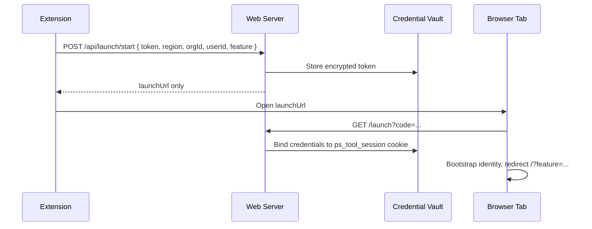

# Launch Endpoint

Secure handoff from the Chrome extension to the PS Tool web app using signed requests, a server-side credential vault, and one-time launch codes.

## Overview

The extension reads Genesys Cloud auth from the active tab **in memory only** (not stored in `chrome.storage`). Each feature launch calls **`POST /api/launch/start`**. The server validates the token against Genesys, stores an encrypted vault entry, returns a one-time **`launchUrl`**, and the browser tab consumes the launch code to bind credentials to the `ps_tool_session` cookie.

Legacy **`POST /api/launch/pair`** + **`POST /api/launch/handoff`** (link token in extension storage) remain for compatibility but are **not** used by the current extension build.



## Environment

| Variable | Purpose |
| --- | --- |
| `VAULT_ENCRYPTION_KEY` | 32-byte hex key (64 characters) for AES-256-GCM token encryption |
| `LAUNCH_HMAC_SECRET` | Optional HMAC secret for signed extension requests (recommended in production) |
| `LAUNCH_BASE_URL` | Public base URL for launch redirects (defaults to request host) |
| `LAUNCH_VAULT_TTL_MS` | Vault entry lifetime (default 8 hours) |
| `LAUNCH_CODE_TTL_MS` | One-time launch code lifetime (default 60 seconds) |

Generate a vault key:

```bash
node -e "console.log(require('crypto').randomBytes(32).toString('hex'))"
```

## API

### `POST /api/launch/start` (recommended)

Single-hop launch used by the extension. Validates org and user against Genesys API, creates vault entry and launch code, returns URL only (no link token to the client).

```json
{
  "region": "us-east-1",
  "token": "<bearer>",
  "orgId": "<uuid>",
  "userId": "<uuid>",
  "feature": "genesys-users",
  "params": { "conversationId": "abc-123" }
}
```

Response:

```json
{
  "launchUrl": "http://localhost:3000/launch?code=a1b2c3d4"
}
```

Rate limit: 30 requests / 15 minutes per IP (in addition to optional HMAC).

### `POST /api/launch/pair` (legacy)

One-time pairing for link-token handoff flow.

```json
{
  "region": "us-east-1",
  "token": "<bearer>",
  "orgId": "<uuid>",
  "userId": "<uuid>"
}
```

Response includes `linkToken` for subsequent handoff calls.

### `POST /api/launch/handoff` (legacy)

Feature launch after pairing.

```json
{
  "linkToken": "<opaque>",
  "feature": "genesys-users",
  "params": { "conversationId": "abc-123" }
}
```

Response:

```json
{
  "code": "a1b2c3d4",
  "launchUrl": "http://localhost:3000/launch?code=a1b2c3d4"
}
```

### `POST /api/launch/unpair`

Revokes a link token and vault entry.

### `GET /launch?code=...`

Consumes a one-time code, binds vault credentials to the `ps_tool_session` cookie, writes org/user identity to `localStorage` (not the Genesys token), and redirects to `/?feature=<feature>`.

### `POST /api/launch/disconnect`

Clears session-scoped vault credentials **and** session export/cache data for the current browser session.

## Security Model

| Control | Detail |
| --- | --- |
| Token transit | Genesys bearer sent per `start` (or once at legacy pair) over HTTPS; extension does not persist token |
| Vault storage | AES-256-GCM encrypted token in SQLite; link tokens stored as SHA-256 hashes |
| Session binding | Launch code binds vault entry to `ps_tool_session` cookie |
| Web API calls | Production default: vault mode only (`PS_TOOL_ALLOW_MANUAL_AUTH=1` to allow token/PKCE UI) |
| Schema validation | Allowlisted fields; unknown keys rejected (`validateStartBody`, pair, handoff) |
| Feature allowlist | Only known `genesys-*` feature IDs accepted |
| Body size limit | 4 KB on launch POST routes |
| Rate limiting | start 30/15min, pair 10/15min, handoff 60/15min, GET /launch 30/15min per IP |
| HMAC signing | Optional `X-PS-Tool-Timestamp` + `X-PS-Tool-Signature` headers |
| Bootstrap | Server-side JSON.stringify of escaped bootstrap payload; no reflected user input |
| Logging | Tokens and link tokens are never logged |

**HTTPS policy:** Required outside `localhost` / `127.0.0.1`.

See also [`docs/security-audit-corporate-policy.md`](security-audit-corporate-policy.md) for corporate policy alignment and env flags (`PS_TOOL_ALLOW_MANUAL_AUTH`, export retention, backups).

## Extension Setup

1. Load unpacked from `extension/` in Chrome.
2. Open extension options and set PS Tool base URL (default `http://localhost:3000`).
3. Optionally set **Launch HMAC secret** to match `LAUNCH_HMAC_SECRET` in `.env`.
4. Open a Genesys Cloud tab with an active session.
5. Click the extension icon to open the side panel.
6. Click any export or bulk button — the web app opens on the target feature via launch URL.

Quick Navigation buttons open Genesys admin URLs directly and do not use the launch endpoint.

## Feature Mapping

See [`docs/migration-matrix.md`](migration-matrix.md) and `extension/js/constants.js` for button ID → `feature` param mappings.

Conversation features accept an optional `conversationId` param:

- `genesys-report-conversation`
- `genesys-report-interaction`
- `genesys-report-flow`

## Testing

```bash
npm test
```

The launch security script validates schema rules (including `validateStartBody`), HMAC verification, encryption round-trips, and rate limiter behavior without a running server.
